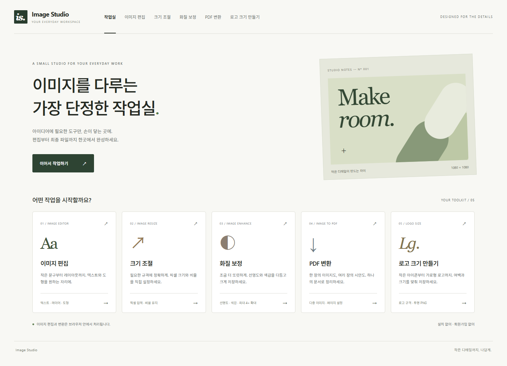
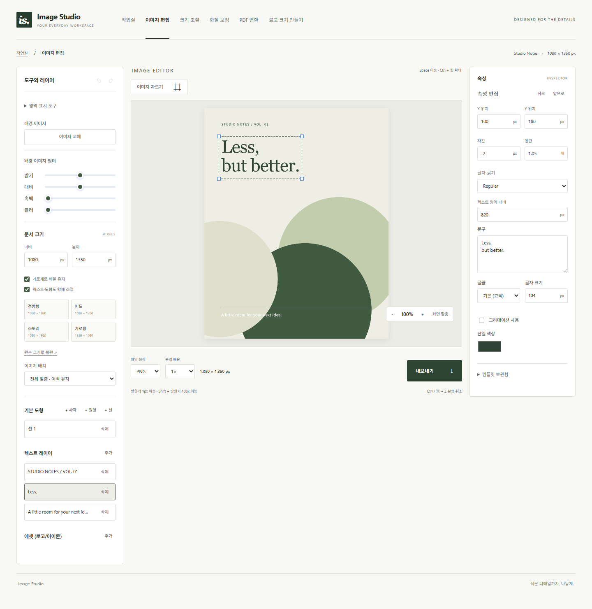
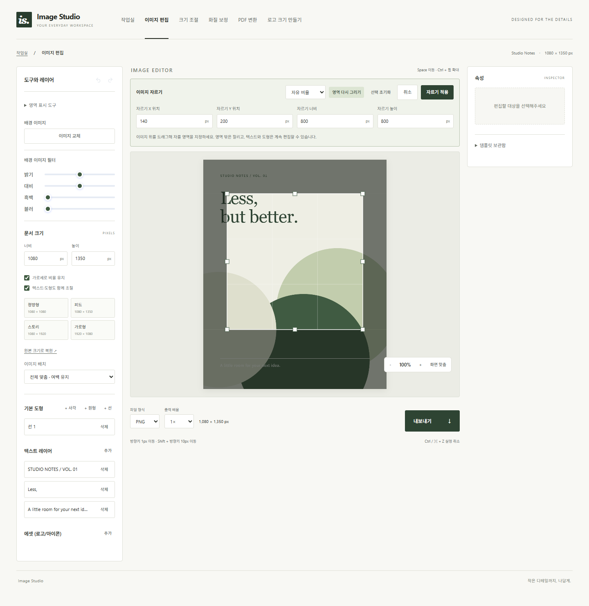
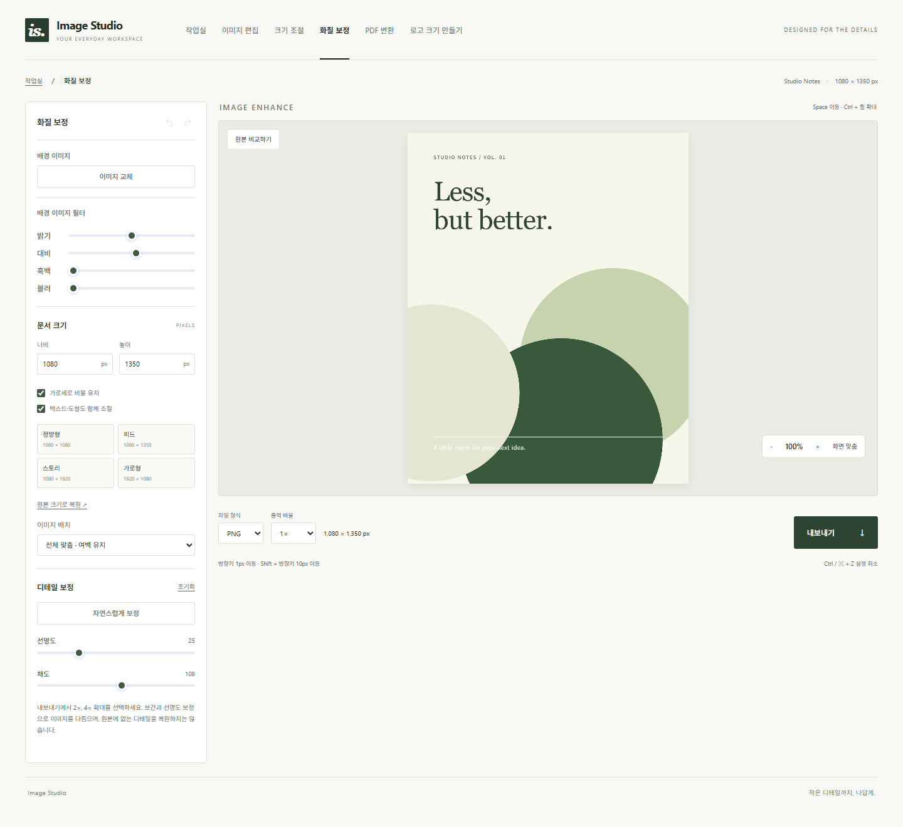
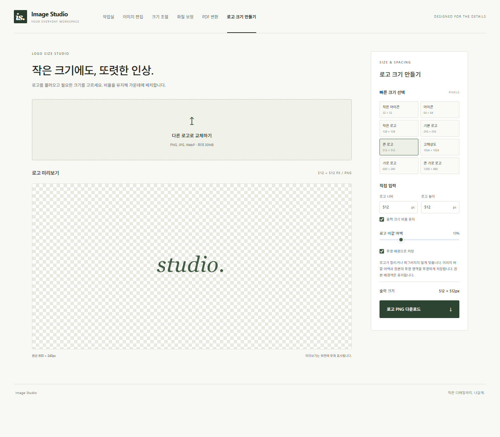
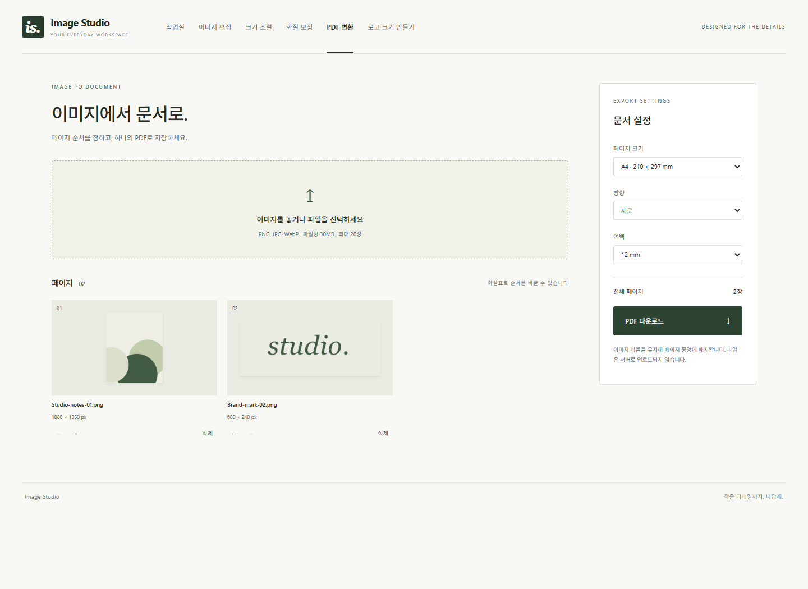
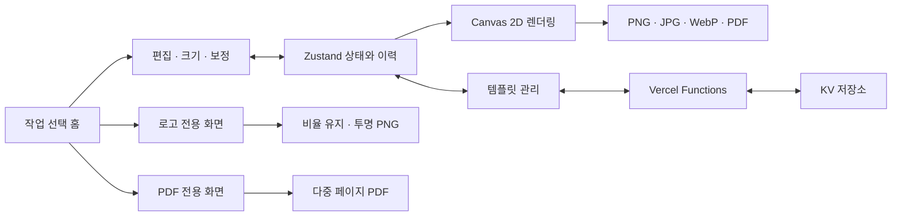

# Image Studio

**정밀한 이미지 편집부터 로고 제작, PDF 변환까지 연결하는 브라우저 기반 디자인 작업실**

[서비스 바로가기](https://image-editor-omega-lilac.vercel.app/) · [기술 구현](#3-접근과-의사결정) · [전체 화면 캡처](#화면-미리보기) · [로컬 실행](#실행-방법)

React와 Canvas 2D로 만든 이미지 편집 서비스입니다. 하나의 화면에 모여 있던 도구를 **이미지 편집·크기 조절·화질 보정·PDF 변환·로고 크기 만들기**의 다섯 작업으로 구성하고, 픽셀 단위의 편집과 파일 출력까지 이어지도록 확장했습니다.



## 1. 문제 정의

기존 편집기는 이미지에 문구와 도형을 넣을 수 있었지만, 실제 디자인 작업에서 필요한 정밀도와 출력 규격을 다루는 데 제약이 있었습니다.

| 기존 제약 | 사용자가 겪는 문제 | 개선 방향 |
| --- | --- | --- |
| 한 화면에 편집 도구 집중 | 작업 목적에 맞는 기능을 찾기 어려움 | 작업 선택 홈과 목적별 화면 분리 |
| 최소 글자 크기 20px | 작은 설명, 출처, 로고 문구 배치가 어려움 | 1px부터 입력, 자간·행간·좌표 조절 |
| 캔버스 기준 너비 600px | 원하는 실제 이미지 규격을 지정하기 어려움 | 원본 크기 유지와 가로·세로 직접 입력 |
| 속성 패널 중심의 크기 변경 | 크기와 위치를 번갈아 수정해야 함 | 선택 박스 모서리 드래그로 텍스트 크기 조절 |
| 이미지 저장 중심의 작업 흐름 | 자르기·로고 규격·문서를 따로 처리해야 함 | 편집 가능한 자르기, 로고 전용 도구, 다중 페이지 PDF |
| 미리보기 캔버스를 그대로 저장 | 선택 테두리와 조절점이 출력될 수 있음 | 편집 표시를 제외하는 별도 출력 렌더링 |

목표는 **작업 화면에서 보이는 위치·크기가 저장 파일에도 일관되게 반영되고, 잘못 편집해도 되돌릴 수 있는 도구**를 만드는 것이었습니다.

## 2. 담당 범위

개인 저장소의 기존 편집기를 대상으로 서비스 흐름과 UI, 편집 로직, 파일 변환 및 검증을 개발·개선했습니다.

- **서비스 구조와 UI:** 작업 선택 홈, 도구·캔버스·속성 패널, 반응형 레이아웃, 로고·PDF 전용 화면.
- **편집 엔진:** 텍스트·도형·에셋 선택과 이동, 텍스트 리사이즈, 이미지 크기 변경, 자르기, 키보드 조작.
- **상태와 이력:** Zustand 기반 편집 상태, 다중 선택 삭제, 실행 취소·다시 실행, 이미지 교체 및 크기 변경 복구.
- **이미지와 문서 출력:** 선명도 보정, PNG/JPG/WebP/PDF 저장, 로고 투명 배경, 다중 페이지 PDF.
- **검증과 배포:** 좌표·비율·경계·이력 회귀 테스트, 빌드 확인, GitHub와 Vercel을 통한 배포.

## 3. 접근과 의사결정

### Canvas 2D를 편집과 출력의 공통 기준으로 사용

DOM 요소를 별도로 배치하고 캡처하는 방식 대신, 기존 Canvas 2D 렌더링을 확장했습니다. 이미지·도형·에셋·텍스트를 같은 픽셀 좌표계에서 그려 미리보기와 저장 결과가 같은 렌더링 규칙을 사용하게 했습니다.

화면 배율과 실제 출력 해상도는 분리했습니다. 포인터 위치를 다음과 같이 캔버스 좌표로 환산하므로 화면을 확대하거나 축소해도 실제 픽셀 위치를 기준으로 편집합니다.

```text
canvasX = (clientX - 화면상 캔버스 왼쪽 좌표) × 실제 캔버스 너비 / 화면상 너비
canvasY = (clientY - 화면상 캔버스 위쪽 좌표) × 실제 캔버스 높이 / 화면상 높이
```

출력할 때는 별도의 캔버스를 만들고 `clean` 옵션으로 선택 테두리·조절점·가이드를 제외합니다. 에셋 이미지 로딩과 폰트 준비를 기다린 뒤 저장해, 준비되지 않은 이미지가 누락되는 경우도 방지합니다.

구현: [CanvasPreview.jsx](src/components/CanvasPreview.jsx) · [useCanvasEvents.js](src/hooks/useCanvasEvents.js) · [StudioExport.jsx](src/components/canvas/StudioExport.jsx)

### 텍스트 렌더링과 선택 판정에 같은 측정 로직 적용

글자 수로 선택 영역을 추정하면 글꼴, 작은 글자, 여러 줄 문장에서 실제 표시와 클릭 영역이 달라집니다. `textLayout`에서 `measureText`로 줄바꿈·너비·높이를 계산하고, 렌더링과 선택 판정에 함께 사용했습니다.

텍스트 크기를 조절할 때는 드래그 시작 시점의 글자 크기와 경계에서 배율을 계산합니다. 반대쪽 모서리를 고정하면서 글자 크기·자간·텍스트 영역 너비를 함께 변경해 줄바꿈을 유지합니다. 매 이동마다 시작 스냅샷에서 계산해 연속 드래그의 오차 누적을 피했습니다.

구현: [imageTools.js](src/lib/imageTools.js) · [textResize.js](src/lib/textResize.js) · [PropertyEditor.jsx](src/components/panel/PropertyEditor.jsx)

### 자른 뒤에도 텍스트와 도형을 편집 가능하게 유지

디자인 전체를 한 장의 이미지로 합쳐 자르면 이후 텍스트와 도형을 수정하기 어렵습니다. 배경 이미지의 선택 영역을 추출하고, 각 요소의 위치에서 자르기 시작 좌표를 빼는 방식으로 캔버스를 재구성했습니다.

```text
newX = originalX - cropX
newY = originalY - cropY
```

글자·도형 크기를 유지하고 자동 줄바꿈 너비도 기존 값으로 고정합니다. 영역 밖 요소는 캔버스 경계에서 잘려 보이지만 객체 데이터는 유지됩니다. 자르기 전체를 하나의 이력으로 기록해 Ctrl+Z 한 번으로 원래 이미지·규격·배치를 복구합니다.

SVG 오버레이가 선택 영역·삼등분 가이드·8방향 손잡이를 표시하고, 포인터 캡처로 드래그를 처리합니다. 자르기를 준비하는 동안 문서 상태가 변경되면 오래된 결과를 적용하지 않도록 검사합니다.

구현: [CropTool.jsx](src/components/canvas/CropTool.jsx) · [cropTools.js](src/lib/cropTools.js) · [useEditorStore.js](src/store/useEditorStore.js)

### 불변 상태 갱신과 작업 단위 이력 관리

Zustand에 편집 상태와 액션을 모으고, `past`·`future` 스냅샷으로 실행 취소와 다시 실행을 구성했습니다. 배열과 객체를 불변 방식으로 갱신해 이전 상태가 후속 편집에 의해 바뀌지 않도록 했습니다. 과거 이력은 최대 30개로 제한합니다.

여러 요소를 Delete로 지우는 작업과 한 번의 리사이즈·자르기를 각각 하나의 이력으로 묶었습니다. 입력란·편집 가능한 요소·한글 조합 중에는 전역 삭제 단축키가 작동하지 않도록 분기했습니다.

구현: [useEditorStore.js](src/store/useEditorStore.js) · [useShortcuts.js](src/hooks/useShortcuts.js)

### 브라우저에서 이미지 처리, 큰 출력은 사전 제한

이미지 보정·리사이즈·로고 저장·PDF 변환은 브라우저에서 처리합니다. 밝기·대비·채도·흑백·블러는 Canvas 필터로 적용하고, 선명도는 주변 픽셀과의 차이를 강조하는 커널로 계산합니다. 배경 처리 결과를 `useMemo`로 유지해 요소를 이동할 때마다 필터와 선명도 계산을 다시 하지 않도록 했습니다.

고해상도 캔버스의 메모리 사용을 제어하기 위해 파일당 30MB, 한 변 8,192px, 총 1,600만 픽셀의 경계를 검사합니다. 2×·4× 출력에도 같은 픽셀 제한을 적용합니다. 확대는 보간과 선명도 처리이며, 생성형 AI로 없는 디테일을 복원하는 기능은 아닙니다.

로고 전용 화면은 종횡비를 유지해 가운데 배치하고 투명 영역을 채우지 않아 PNG 알파 채널을 보존합니다. 일반 편집 화면의 흰색 배경 출력과 용도를 분리했습니다.

구현: [imageTools.js](src/lib/imageTools.js) · [logoTools.js](src/lib/logoTools.js) · [LogoWorkspace.jsx](src/components/LogoWorkspace.jsx)

### PDF 생성과 템플릿 저장의 책임 분리

PDF 화면은 최대 20장의 이미지 순서·페이지 크기·방향·여백을 관리합니다. 원본을 차례로 디코딩해 페이지에 넣고 임시 캔버스를 해제하며, 목록에는 작은 썸네일을 사용합니다. `jsPDF`는 PDF 저장 시점에 동적으로 가져와 별도 청크로 분리했습니다.

클라우드 기능은 템플릿 메타데이터 저장에 한정했습니다. `/api/templates`가 사용자 식별자와 목록 형식을 검증하고 KV 저장소와 통신하며, 이미지 편집 과정은 해당 API의 성공 여부에 의존하지 않습니다. KV를 사용할 수 없는 경우에도 기본 편집·로고·PDF 작업은 가능합니다.

구현: [PdfWorkspace.jsx](src/components/PdfWorkspace.jsx) · [TemplateManager.jsx](src/components/TemplateManager.jsx) · [templates.js](api/templates.js)

## 4. 결과와 검증

| 항목 | 결과 |
| --- | --- |
| 작업 진입 | 단일 편집 화면에서 **목적별 5개 작업 화면**으로 확장 |
| 최소 글자 크기 | **20px → 1px**, 모서리 드래그 및 소수점 좌표 입력 지원 |
| 캔버스 규격 | 기준 너비 **600px 고정 → 가로·세로 직접 입력**, 최대 8,192px·1,600만 픽셀 이내 |
| 저장 형식 | **PNG·JPG·WebP·PDF** 지원 |
| 출력 배율 | **1×·2×·4×**, 출력 크기 제한 사전 검사 |
| 로고 규격 | **8개 프리셋**과 사용자 지정 크기, 투명 PNG |
| 다중 이미지 PDF | 한 문서에 **최대 20장**, 순서·방향·여백 지정 |
| 편집 복구 | **최대 30개 과거 상태**, 다중 삭제·리사이즈·자르기 단위 복구 |
| 자동 검증 | **4개 테스트 파일, 17개 테스트 통과**, 실패 0개 |
| 빌드 | `npm run build` 통과, PDF 라이브러리 별도 청크 생성 확인 |

검증 기준일: **2026-11-04**. 위 수치는 구현 범위와 실행한 검사 결과입니다. 응답 속도·이용자 수·업무 시간 감소는 별도로 측정하지 않아 성과 수치에 포함하지 않았습니다.

| 테스트 | 주요 검증 범위 |
| --- | --- |
| [image-tools.test.js](tests/image-tools.test.js) · 5개 | 크기 제한, 요소 비례 조절, 이미지 교체와 이력, 선명도, 작은 글자 줄바꿈 |
| [text-resize.test.js](tests/text-resize.test.js) · 3개 | 네 모서리의 고정점, 확대·축소 경계, 줄바꿈 영역 유지 |
| [logo-tools.test.js](tests/logo-tools.test.js) · 4개 | 비율 유지, 여백, 출력 제한, 투명·단색 배경 처리 |
| [crop-tools.test.js](tests/crop-tools.test.js) · 5개 | 드래그 방향, 비율, 8방향 경계, 요소 좌표 보존, 실행 취소·다시 실행 |

## 5. 회고와 배운 점

**좌표계의 일관성이 편집 도구의 사용성을 결정했습니다.** 작은 글자, 확대된 화면, 자르기, 저장 배율은 모두 서로 다른 크기를 다룹니다. 화면상 좌표와 실제 픽셀 좌표를 분리하고 측정 로직을 공유해야 선택 영역과 결과물이 어긋나지 않았습니다.

**사용자의 작업 한 번을 상태 변경 한 번으로 다루는 것이 중요했습니다.** 다중 선택 삭제를 요소별 이력으로 남기거나 자르기에서 크기만 복구하면 사용자가 기대하는 되돌리기와 달라집니다. 이미지·규격·요소 배치를 함께 복구하는 경계를 정하고 회귀 테스트로 고정했습니다.

**완성된 이미지와 편집 가능한 문서는 다른 데이터 모델이 필요했습니다.** 자르기에서 객체를 합치지 않는 방식, 출력에서 선택 표시를 제외하는 방식, 로고의 투명 배경을 일반 편집과 분리하는 방식이 그 차이에서 나왔습니다.

다시 설계한다면 다음을 우선 개선하고 싶습니다.

- **고해상도 처리:** 메인 스레드의 선명도 계산을 Web Worker·OffscreenCanvas로 옮기고, 해상도별 처리 시간과 최대 메모리 측정하기.
- **작업 영속화:** 새로고침 시 초기화되는 편집 내용을 IndexedDB에 저장하고, 원본 이미지와 레이어를 함께 복원하는 프로젝트 파일 형식 도입하기.
- **상태 구독 범위:** Zustand selector로 구독 범위를 좁혀 재렌더링을 줄이고 실제 프로파일링으로 검증하기.
- **템플릿 접근 제어:** 브라우저 식별자 기반 저장을 계정 인증과 소유권 검증으로 확장하기. 현재 식별자를 인증 수단으로 간주하지 않기.
- **검증 확장:** 기하·상태 단위 테스트에 더해 포인터 조작, 다운로드 파일, 투명 픽셀을 확인하는 브라우저 E2E 회귀 검사 추가하기.

## 화면 미리보기

실제 애플리케이션에 데모 데이터를 넣어 캡처했습니다. **모든 이미지는 가로 1,440px의 전체 화면**이며, 패널 높이 제한은 캡처 환경에서만 해제해 하단 메뉴와 푸터가 잘리지 않도록 했습니다. 이미지는 원본 비율로 표시되며, 클릭하면 전체 해상도로 볼 수 있습니다.

<details open>
<summary><strong>정밀 편집 · 텍스트 선택 박스와 속성 패널</strong></summary>

[](docs/screenshots/02-precision-editor.png)

</details>

<details>
<summary><strong>이미지 자르기 · 영역 지정과 픽셀 입력</strong></summary>

[](docs/screenshots/03-crop.png)

</details>

<details>
<summary><strong>화질 보정 · 필터와 선명도, 원본 비교</strong></summary>

[](docs/screenshots/04-enhance.png)

</details>

<details>
<summary><strong>로고 크기 만들기 · 규격, 여백, 투명 배경</strong></summary>

[](docs/screenshots/05-logo.png)

</details>

<details>
<summary><strong>PDF 변환 · 이미지 목록과 페이지 설정</strong></summary>

[](docs/screenshots/06-pdf.png)

</details>

## 기술 스택과 구조

| 영역 | 기술과 역할 |
| --- | --- |
| UI | React 19, CSS, Vite 8 |
| 편집 상태 | Zustand 5, 불변 갱신, 스냅샷 이력 |
| 그래픽 | Canvas 2D, SVG 오버레이, Pointer Events, ResizeObserver |
| 파일 처리 | File API, Blob, Object URL, PNG/JPEG/WebP 인코딩 |
| PDF | jsPDF 4, 동적 import |
| 템플릿 API | Vercel Functions, `@vercel/kv` |
| 검증·배포 | Node.js Test Runner, GitHub, Vercel |



편집기는 Zustand를 공유하고, 로고·PDF는 각 화면의 React 상태로 목록과 설정을 관리합니다. 별도 화면은 마운트를 유지해 탭 이동 중 작업을 보존합니다. 기하 계산과 픽셀 처리 함수는 `src/lib`로 분리했습니다.

```text
src/
├── App.jsx                     # 홈과 작업 화면 전환
├── components/
│   ├── CanvasPreview.jsx       # 공통 렌더러와 편집 표시
│   ├── LogoWorkspace.jsx       # 로고 규격과 투명 PNG
│   ├── PdfWorkspace.jsx        # 다중 이미지 PDF
│   ├── canvas/                 # 자르기, 내보내기
│   └── panel/                  # 크기, 배경, 레이어 속성
├── hooks/                      # 포인터와 키보드 이벤트
├── lib/                        # 이미지·로고·자르기·텍스트 계산
└── store/useEditorStore.js      # 상태, 선택, 편집 이력
api/templates.js                # 템플릿 조회·저장
tests/                          # 기하·픽셀·상태 회귀 테스트
docs/screenshots/               # 전체 화면 캡처 6장
```

## 실행 방법

검증 환경은 Node.js **22.14.0**입니다. 의존성은 잠금 파일 기준으로 설치합니다.

```sh
git clone https://github.com/gyeonggumun/image-editor.git
cd image-editor
npm ci
npm run dev
```

터미널에 표시되는 로컬 주소로 접속합니다. 일반 Vite 개발 서버에서는 이미지 편집·보정·로고·PDF를 사용할 수 있으며, `/api/templates`는 Vercel Functions 실행 환경이 필요합니다.

```sh
# 회귀 테스트 17개
node --test tests/image-tools.test.js tests/text-resize.test.js tests/logo-tools.test.js tests/crop-tools.test.js

# 배포용 빌드와 결과 확인
npm run build
npm run preview
```

클라우드 템플릿을 사용할 경우 Vercel 서버 환경에 다음 변수를 설정합니다. 클라이언트에 노출되는 `VITE_` 접두사는 붙이지 않습니다.

```dotenv
KV_REST_API_URL=your-kv-rest-url
KV_REST_API_TOKEN=your-server-token
```

## 현재 지원 범위

- 입력: PNG·JPEG·WebP, 파일당 30MB 이하. 입력·출력 모두 한 변 8,192px 및 총 1,600만 픽셀 이하.
- 일반 편집: 빈 영역과 투명 영역은 흰색으로 출력. 로고 도구는 투명 영역을 유지하며 PNG 저장.
- 화질 보정: 보간 확대와 필터·선명도 조절. 생성형 이미지 복원이나 배경 제거는 제공하지 않음.
- 영역 마스크: 영역 표시까지만 지원하며 실제 개체 삭제는 수행하지 않음.
- 작업 저장: 도구 이동 중 상태 유지. 새로고침 시 편집 내용 초기화. 클라우드 템플릿에 배경 이미지 자체는 포함하지 않음.
